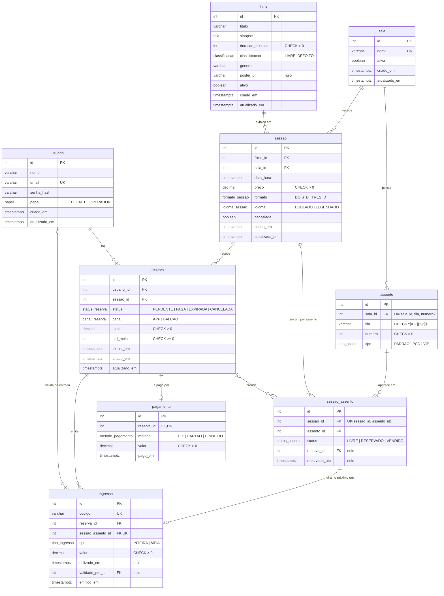

# DER – bilheteria-api

Diagrama gerado a partir de `prisma/schema.prisma` e das migrations `init`, `constraints_check` e `formato_idioma_meia`.

Versão em imagem: [diagrama-entidade-relacionamento.png](diagrama-entidade-relacionamento.png). Nela, os tipos enumerados aparecem com o nome do Prisma (`MetodoPagamento`, `StatusReserva`...); no PostgreSQL eles se chamam `metodo_pagamento`, `status_reserva`... (`@@map`).
Nomes reais do banco (snake_case). Para exportar como imagem: cole o bloco em https://mermaid.live.

## Restrições de integridade

**Unicidade**
- `usuario.email`, `sala.nome`, `ingresso.codigo`
- `assento (sala_id, fila, numero)`: a mesma poltrona não existe duas vezes na sala.
- `sessao_assento (sessao_id, assento_id)`: **um assento tem exatamente uma linha de status por sessão**.
- `ingresso.sessao_assento_id`: **um assento de uma sessão gera no máximo um ingresso**.
- `pagamento.reserva_id`: uma reserva tem no máximo um pagamento.

**CHECK** (migration `constraints_check`)
- `ck_sessao_preco_positivo`, `ck_assento_numero_positivo`, `ck_filme_duracao_positiva`, `ck_reserva_total_positivo`, `ck_pagamento_valor_positivo`
- `ck_assento_fila_formato`: fila com 1 ou 2 letras maiúsculas.
- `ck_sessao_assento_reservado_ate`: `RESERVADO` exige `reservado_ate`.
- `ck_sessao_assento_coerencia_reserva`: `LIVRE` ⇒ sem reserva e sem prazo; `RESERVADO`/`VENDIDO` ⇒ com `reserva_id`.
- Migration `formato_idioma_meia`: `ck_reserva_qtd_meia` (`qtd_meia >= 0`) e `ck_ingresso_valor_positivo` (`valor > 0`).

**Formato, idioma e meia-entrada** (migration `formato_idioma_meia`)
- `sessao.formato` (2D/3D) e `sessao.idioma` (dublado/legendado), com padrão `DOIS_D` e `DUBLADO` para as sessões que já existiam.
- `reserva.qtd_meia`: quantos assentos da reserva são meia-entrada. O total é calculado no servidor: inteiras × preço + meias × metade do preço (arredondada para centavos).
- `ingresso.tipo` e `ingresso.valor`: cada ingresso guarda se é inteira ou meia e quanto foi pago por ele. Os ingressos emitidos antes da migration receberam `INTEIRA` e o preço da sessão.

**Chaves estrangeiras (ON DELETE)**
| FK | Regra |
|---|---|
| assento.sala_id → sala | CASCADE |
| sessao.filme_id → filme, sessao.sala_id → sala | RESTRICT |
| sessao_assento.sessao_id → sessao | CASCADE |
| sessao_assento.assento_id → assento, sessao_assento.reserva_id → reserva | RESTRICT |
| reserva.sessao_id → sessao | CASCADE (bloqueado por pagamento/ingresso se houver venda) |
| reserva.usuario_id → usuario | RESTRICT |
| pagamento.reserva_id → reserva | RESTRICT |
| ingresso.reserva_id, ingresso.sessao_assento_id, ingresso.validado_por_id | RESTRICT |

**Índices**: `sessao(sala_id, data_hora)`, `sessao(filme_id)`, `sessao_assento(sessao_id, status)`, `sessao_assento(reserva_id)`, `reserva(status, expira_em)`, `reserva(usuario_id)`, `ingresso(reserva_id)`, além dos índices únicos acima.
